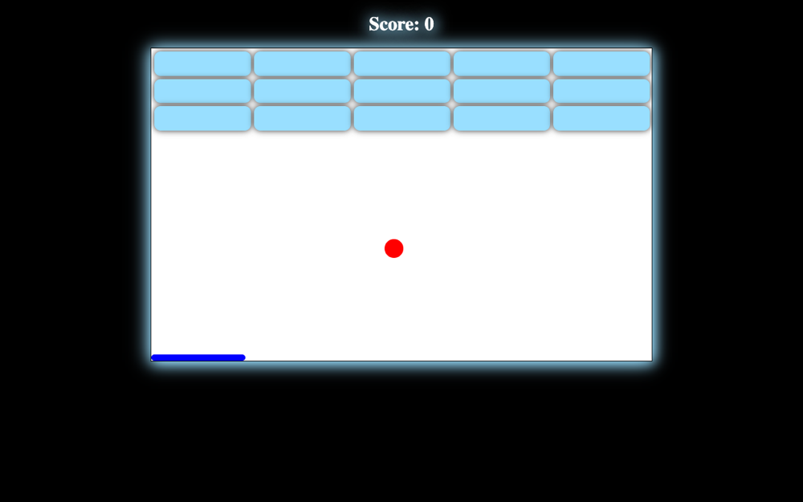

# Arkanoid

An arcade game in the spirit of Super Breakout: bounce the ball with the paddle and break every brick.

**[Play online →](https://ceyhun1999.github.io/Arkanoid-game/)**

<p align="center"></p>

## How to play

- **←** / **→** move the paddle
- The ball bounces off walls, the paddle and bricks; each broken brick adds to your score
- Break all the bricks to win; let the ball fall and it's game over

## Project structure

```
├── index.html
├── css/
└── javascript.js   # ball, bar and bricks objects, collisions
```

## Run locally

No build step. Open `index.html` in a browser, or start a local server:

```bash
python3 -m http.server 8000
```

Then go to http://localhost:8000.

## Tech stack

HTML · CSS · JavaScript (no libraries)
